  &nbsp;&nbsp;
  &nbsp;&nbsp;
  &nbsp;&nbsp;
  

# JitterMap

Fleet-level retry admission with replayable evidence. JitterMap answers a system question that client-local backoff cannot: when many independently reasonable clients encounter one correlated failure, which retries should the fleet admit, defer, or deny?

## Capabilities

- deterministic discrete-event simulation with seeded full jitter;
- local, real AWS RetryConfig, adaptive drop/deferral, and deterministic tenant-fair strategies;
- aggregate and per-tenant RAF, success, denial, deferral, p95, and Jain fairness evidence;
- real RuVector outcome insert/search/read-back;
- real RVF witness-chain sealing;
- bounded Rust process boundaries for Ruflo registry discovery plus real Darwin numeric evolution and Flywheel replay verification, with append-only receipts and authority none. Ruflo reruns require an initialized project-local policy anchor.

## Quickstart

    cargo run --locked -p jitter-cli --bin jitter-map -- --scenario examples/correlated-outage.json --policy adaptive --memory .jitter-map-memory
    cargo run --locked -p jitter-cli --bin jitter-map -- --scenario examples/correlated-outage.json --policy adaptive-deferral --memory .jitter-map-memory
    cargo run --locked -p jitter-cli --bin jitter-map -- --scenario examples/skewed-tenant-outage.json --policy tenant-fair-budget --memory .jitter-map-memory
    cargo run --locked -p jitter-cli --bin jitter-map -- --scenario examples/skewed-tenant-outage.json --policy weighted-tenant-fair-budget --memory .jitter-map-memory
    cargo run --locked -p jitter-cli --bin jitter-map -- --scenario fixtures/fleet-retry-storm-22.json --policy weighted-tenant-fair-budget --memory .jitter-map-memory --interrupt-after 6 --checkpoint-out /tmp/checkpoint.json
    cargo run --locked -p jitter-cli --bin jitter-map -- --scenario fixtures/fleet-retry-storm-22.json --policy weighted-tenant-fair-budget --memory .jitter-map-memory --replay /tmp/checkpoint.json
    cargo run --locked -p jitter-evaluation --bin jitter-benchmark
    cargo run --locked -p jitter-evaluation --bin jitter-fairness-benchmark

`--policy` accepts `local`, `aws`, `adaptive`, `adaptive-deferral`, `tenant-fair-budget`, or `weighted-tenant-fair-budget`. Equal-share fairness admits one event per non-empty tenant per round; demand-weighted fairness admits each tenant's validated scenario weight per round. Both rotate the starting tenant by tick and preserve shared-budget drop semantics; see [ADR-0021](docs/adrs/0021-tenant-fairness.md). The JSON receipt includes the exact scenario digest, typed aggregate/per-tenant report, nearest prior outcome IDs, witness root, and authority none.

MetaHarness evaluation uses `jitter-candidate`, which exposes the same compiled domain engine for numeric evaluation. The current Rust-driven receipt runs Darwin 0.10.3 `evolve-numeric` with the frozen genome and candidate evaluator, then executes Flywheel 0.1.12 generation and replay verification. Both remain advisory and have no repository promotion authority.

## Execution and data flow

## Workspace

22 crates (ADR-0027, ADR-0101–ADR-0122), one bounded context per row of
docs/architecture.md §2:

| Crate | Responsibility |
|---|---|
| jitter-scenario, jitter-workload, jitter-policy, jitter-budget, jitter-scheduler, jitter-outcome | Domain Core: pure, deterministic scenario/policy/budget/scheduling/outcome model |
| jitter-simulation, jitter-recovery | Domain Orchestration: the tick-loop kernel and checkpoint/replay |
| jitter-ports, jitter-application | Hexagonal Boundary: 5 port traits and the use case orchestrating them |
| jitter-adapter-aws, jitter-adapter-ruvector, jitter-adapter-rvf, jitter-adapter-ruflo, jitter-adapter-metaharness | Infrastructure Adapters: executed AWS/RuVector/RVF boundaries plus bounded Ruflo, Darwin, and Flywheel process runners with fail-closed receipts |
| jitter-evidence, jitter-config, jitter-observability | Cross-Cutting Support: receipt binding, typed config, tracing |
| jitter-service, jitter-cli | Composition Roots: the HTTP service and the `jitter-map` CLI binary |
| jitter-evaluation, jitter-contract-tests | Fitness Evaluation and Contract Verification |

See docs/architecture.md for the full dependency-direction diagram and
`scripts/check_dependency_direction.py` for the automated check that enforces it.

## Upstream composition

| Ingredient | Executed contribution | Pin |
|---|---|---|
| AWS SDK for Rust | constructs/translates aws_smithy_types retry config | 193882fe11fce9b22424ac913eeb4d03963d5700 |
| RuVector | VectorDB insert/search/get outcome memory | source 5a93328f, crate 2.3.1 |
| RVF | witness creation and verification | rvf-crypto 0.2.0 |
| MetaHarness | Rust launches Darwin `evolve-numeric` against the frozen genome and real `jitter-candidate`; the repository bridge then executes Flywheel generations and verifies the replay bundle. Both are advisory only | source 9ce8b8d, packages 0.10.3/0.1.12 |

## Architecture and evidence

The [specification](docs/specification.md), [architecture](docs/architecture.md), [50 ADRs](docs/adrs/index.md) (27 design, 0001–0027, plus 23 implementation, 0101–0123), [12 DDD documents](docs/ddd/index.md), [frozen contract](docs/implementation-contract.md), [research](docs/research.md), and [traceability](docs/traceability.md) define the build. CI results and benchmark receipts are recorded under evidence.

## Frozen benchmark

The deterministic fixture contains 400 requests from eight tenants, a six-tick correlated throttling outage, capacity 25 per tick, seed 20261004, and a 200-tick horizon. All strategies consume the same scenario digest:
`bad5f95828899a03ce5858b97e1ddcffaecae89a79b824cbc0acf9cc469b3c9b`.

| Strategy | RAF | Successes | p95 | Attempts | Denied | Deferred | Jain fairness |
|---|---:|---:|---:|---:|---:|---:|---:|
| Local full jitter | 5.4375 | 364 | 24 | 2,175 | 0 | 0 | 0.9855 |
| AWS standard | 3.0000 | 0 | 0 | 1,200 | 0 | 0 | n/a |
| Adaptive shared budget | 5.3050 | 332 | 24 | 2,122 | 38 | 0 | 0.9365 |
| Adaptive deferral | 5.4425 | 329 | 24 | 2,177 | 0 | 55 | 0.9270 |
| Tenant-fair budget | 5.2875 | 336 | 23 | 2,115 | 38 | 0 | 0.9980 |
| Weighted tenant-fair budget | 5.2875 | 336 | 23 | 2,115 | 38 | 0 | 0.9980 |

The tenant-fair policy produced the best adaptive RAF, p95, successes, and fairness on the balanced fixture, but this remains a deterministic model rather than production proof. Deferral eliminated immediate denials but regressed RAF and successes versus drop. The AWS baseline exhausted its three attempts during the outage. Raw output is in [evidence/benchmark.json](evidence/benchmark.json).

### Skewed-tenant fairness ablation

A second frozen fixture assigns demand weights `[8,1,1,1,1,1,1,1]`. Equal-share tenant admission raised Jain fairness from **0.1250** to **0.8932**, with 63 successes. Demand-weighted admission raised fairness further to **0.9684** and recovered two successes (65), at the same 3.7100 RAF. It still trails the adaptive-drop baseline's 72 successes, so promotion remains blocked. Raw output is in [evidence/fairness-benchmark.json](evidence/fairness-benchmark.json).

## Maturity and limitations

This is a pre-1.0 evaluation system, not an SDK interceptor, deployment controller, or claim of production superiority. Neither tenant-fair candidate preserves the adaptive-drop success baseline on the skewed fixture. The discrete-event model does not reproduce every network, SDK, or scheduler behavior. RuVector local file storage is evaluation-only; production persistence must remain behind authorized RuVector/Cloud SQL infrastructure. MetaHarness can propose and score policy candidates but cannot promote them. No component may self-promote a policy. The MetaHarness Rust process round-trip is proven locally against installed Darwin/Flywheel artifacts. Ruflo registry discovery succeeded once through the Rust runner, but a later rerun failed closed after generated policy anchors were removed; fresh execution requires Ruflo's interactive policy initialization and no interactive guard was bypassed.
