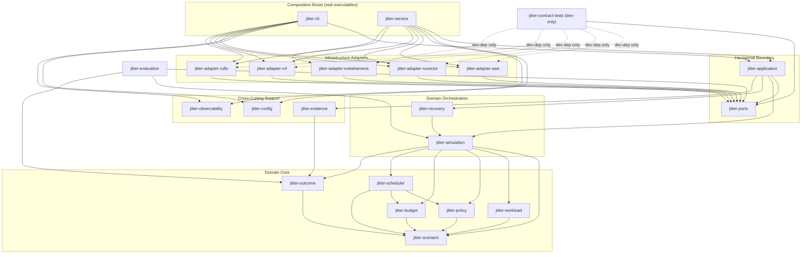

# Architecture

> **CURRENT-STATE WARNING.** Base commit `3db7fd2` ships **6 packages** implementing a
> monolithic domain/application split (CLI, Application, Deterministic engine, AWS
> RetryConfig, RVF witness, RuVector memory, plus a Darwin/Flywheel evaluation
> boundary folded into Application). This base is **NONCOMPLIANT** with the bounded-context
> architecture defined below. Everything past this point — the 22-crate table, the
> dependency rules, the staged migration, the failure/replay path — is a **PLANNED
> design**, not a description of code that exists. No crate in the table below counts
> as compliant until it is implemented, passes the structural checker described at the
> end of this document, *and* passes the semantic acceptance test named in its row. A
> crate that exists only as a `Cargo.toml` and an empty `lib.rs` is not "done" and must
> not be reported as done.

## 1. System thesis

JitterMap exists to answer one question with evidence, not assertion: *when a fleet of
tenants retries against a shared backend after a correlated failure, which admission
policy keeps the system fair and bounded, and can we prove it deterministically and
replay it after a crash?*

The thesis has three load-bearing consequences for the architecture:

1. **The domain must be a pure, deterministic kernel.** Fairness and boundedness claims
   are only trustworthy if the scheduling math has zero dependency on wall-clock time,
   threads, or I/O. Every domain crate (§3) must be provable by unit/property test alone.
2. **Infrastructure must be swappable without touching the kernel.** AWS retry
   configuration, RuVector memory, RVF witnessing, RuFlo orchestration signals, and
   Metaharness evaluation feedback are all *adapters* to the same kernel — not forks of
   it. Ports (§3) are the only contract between the two worlds.
3. **Recovery is not an afterthought.** A fleet retry run that is interrupted mid-tick
   must be resumable to the *same* final outcome as an uninterrupted run. This is a
   first-class bounded context (`jitter-recovery`), not a script bolted onto the CLI.

## 2. Bounded contexts and the context map

| Bounded context | Owns | Crates |
|---|---|---|
| **Domain Core** | Scenario, workload generation, policy, budget, scheduling, outcome — pure value objects, aggregates, domain services | `jitter-scenario`, `jitter-workload`, `jitter-policy`, `jitter-budget`, `jitter-scheduler`, `jitter-outcome` |
| **Domain Orchestration** | Composing Domain Core into one deterministic run; replay from checkpoint | `jitter-simulation`, `jitter-recovery` |
| **Hexagonal Boundary** | Port traits; use-case orchestration generic over ports | `jitter-ports`, `jitter-application` |
| **Infrastructure Adapters** | Concrete implementations of ports against real external systems | `jitter-adapter-aws`, `jitter-adapter-ruvector`, `jitter-adapter-rvf`, `jitter-adapter-ruflo`, `jitter-adapter-metaharness` |
| **Cross-Cutting Support** | Evidence binding, typed config, telemetry — used by, but never depended on by, the domain | `jitter-evidence`, `jitter-config`, `jitter-observability` |
| **Composition Roots** | Real executables that wire adapters into the application via ports | `jitter-service`, `jitter-cli` |
| **Fitness Evaluation** | Scoring competing policy/budget candidates (Darwin/Flywheel) | `jitter-evaluation` |
| **Contract Verification** | Dev-only proof that every adapter satisfies its port contract | `jitter-contract-tests` |

That is 8 bounded contexts, 22 crates. No crate is assigned to more than one context.

## 3. Inward dependency rules

The rule is a strict layering, Cockburn hexagonal / Evans DDD "context map" style:
**dependencies point inward, toward Domain Core; nothing inward ever names anything
outward.**

- Domain Core crates depend on each other only as needed (e.g. `jitter-scheduler` →
  `jitter-policy`, `jitter-budget`, `jitter-scenario`) and on nothing outside the
  workspace's domain layer. No domain crate may depend on `jitter-ports` or any adapter.
- `jitter-simulation` and `jitter-recovery` depend only on Domain Core. They remain free
  of I/O, clocks, and threads — this is enforced structurally (§8), not by convention.
- `jitter-ports` depends on nothing but domain DTOs it re-exports for port signatures. It
  defines traits only; it contains zero implementations.
- `jitter-application` depends on Domain Orchestration + `jitter-ports` **only**. It must
  never name a concrete adapter crate. Dependency injection happens through generics or
  trait objects supplied by the composition root.
- Every `jitter-adapter-*` depends on `jitter-ports` (to implement traits) and its own
  external SDK. No adapter is a dependency of any domain, application, or ports crate —
  the arrow only ever points from adapter inward to port, never the reverse.
- `jitter-evidence`, `jitter-config`, `jitter-observability` are cross-cutting: they may
  be depended on by application, adapters, and composition roots, but they never appear
  in a domain crate's dependency list and they never depend on an adapter.
- `jitter-service` and `jitter-cli` are the only crates permitted to depend on
  *everything* — they are composition roots, the place where concrete adapters are
  chosen and wired into `jitter-application`.
- `jitter-evaluation` depends on Domain Orchestration + `jitter-ports`; it reaches
  `jitter-adapter-metaharness` only at a composition root, never directly.
- `jitter-contract-tests` depends on `jitter-ports` and appears **only** under
  `[dev-dependencies]` of adapter crates. It is never a runtime dependency of anything.

Note the absence of any arrow from `Core` or `Orch` back out to `Hex`, `Adapters`, or
`Roots`. That absence is the architecture; the structural checker (§8) exists to keep it
true as the crate count grows.

## 4. The one real E2E workload: `fleet-retry-storm-22`

Every acceptance criterion in §5 is measured against a single concrete scenario, not an
abstract example, so that "it works" means the same thing in every crate's test suite.

**`fleet-retry-storm-22`**: 500 tenants share one backend. At tick 0 the backend suffers
a correlated outage window of 12 ticks (`FailureWindow{start: 0, len: 12}`). All 500
tenants begin retrying the moment the window opens, with tenant demand weights drawn
from a fixed, checked-in long-tail distribution (a handful of tenants at weight 20, the
long tail at weight 1). The AWS-sourced retry budget caps global concurrent retries at
64 per tick. The scheduler under test is `WeightedTenantFairBudget` (already present in
the current base as the demand-weighted admission path — this is the one piece of the
current implementation this design treats as a correct reference behavior to preserve,
not reinvent).

The workload flows through the full stack end to end:

1. `jitter-cli` loads `fixtures/fleet-retry-storm-22.json`, parses it into a `Scenario`.
2. `jitter-application`'s `RunFleetRetryWorkload` use case validates it via
   `jitter-scenario`, generates the deterministic trace via `jitter-workload`.
3. `jitter-simulation` drives the tick loop through `jitter-scheduler`, consuming
   `jitter-budget` (loaded from `jitter-adapter-aws`) and `jitter-policy`, emitting
   `jitter-outcome` events.
4. On completion, `jitter-evidence` binds a `Receipt` from the `OutcomeSummary` and the
   `WitnessRef` returned by `jitter-adapter-rvf`; `jitter-adapter-ruvector` persists the
   receipt pointer.
5. `jitter-cli` prints the bound `Receipt` as JSON to stdout.
6. A second, mid-run-interrupted execution (killed at tick 6) is resumed via
   `jitter-recovery` from the last checkpoint and must reach the *same* final `Receipt`
   digest as the uninterrupted run (§7).
7. `jitter-evaluation` scores `WeightedTenantFairBudget` against an unweighted baseline
   policy on the same scenario and must rank the weighted policy higher, routed through
   `jitter-adapter-metaharness`.

This one fixture is referenced by name in the acceptance column of every row below that
needs a concrete workload, so that no crate's "it passes" is checked against a different,
cherry-picked example.

## 5. The 22 planned crates

ADRs below are listed as **(new)** — none exist yet. Authoring the named ADR is itself an
implementation task for that crate's migration phase; a crate must not be marked
compliant while its ADR is still a stub.

| # | Crate | Responsibility / bounded context | Typed public API | Real caller / dependency edge | ADR / DDD reference | Implementation tasks | Tests | Acceptance criterion |
|---|---|---|---|---|---|---|---|---|
| 1 | `jitter-scenario` | Domain Core: fleet topology, tenant demand profiles, correlated-failure window as validated value objects | `struct Scenario{tenants, ticks, correlated_failure}` `fn validate(Scenario) -> Result<ValidatedScenario, ScenarioError>` | Consumed by `jitter-workload`, `jitter-policy`, `jitter-budget`, `jitter-outcome`, `jitter-scheduler`, `jitter-simulation` | ADR-0101 Domain Purity Boundary (new); DDD: Value Object, Ubiquitous Language | Extract scenario types out of the current monolith; enforce invariants only at `ValidatedScenario` construction, never re-checked downstream | Property tests: no negative weights, non-empty tick window, failure window inside tick range | `cargo test -p jitter-scenario` green; crate has zero deps outside workspace domain crates (checked by structural checker) |
| 2 | `jitter-workload` | Domain Core: deterministic generation of the retry request trace from a scenario + seed | `fn generate(&ValidatedScenario, seed: u64) -> WorkloadTrace` `WorkloadTrace: Iterator<Item = RetryRequest>` | Consumed by `jitter-simulation`'s tick loop | ADR-0102 Deterministic Generation (new); DDD: Domain Service | Seeded PRNG generator; `RetryRequest{tenant_id, tick, attempt}` | Determinism test: same seed → identical trace hash; golden trace fixture for `fleet-retry-storm-22` | Two independent runs with the same seed produce a byte-identical serialized trace for `fleet-retry-storm-22` |
| 3 | `jitter-policy` | Domain Core: pure decision rule mapping attempt history to next-retry delay/admission | `trait RetryPolicy { fn next_delay(&self, &AttemptHistory) -> Decision; }` + `ExponentialJitter`, `DemandWeighted` impls | Consumed by `jitter-scheduler` | ADR-0103 Policy Strategy Pattern (new); DDD: Strategy, Domain Service | Migrate the current `WeightedTenantFairBudget` decision rule into a `RetryPolicy` impl distinct from budget bookkeeping | Table-driven decision tests per policy; fairness invariant test (no tenant starved beyond N ticks) | `DemandWeighted` policy reproduces the base-commit `3db7fd2` demand-weighted admission output bit-for-bit on `fleet-retry-storm-22` |
| 4 | `jitter-budget` | Domain Core: consumable per-tenant/global retry budget, quantum rotation, exhaustion | `struct Budget{..}` `fn try_consume(&mut self, Weight) -> Result<(), BudgetExhausted>` | Consumed by `jitter-scheduler` each tick | ADR-0104 Budget Value Object (new); DDD: Value Object, Invariant Enforcement | Extract quantum/rotation bookkeeping out of `WeightedTenantFairBudget`, separate from policy decision | Quantum-rotation unit tests; exhaustion edge cases at budget=0 | Round-robin quantum consumption for `fleet-retry-storm-22` matches the `3db7fd2` reference trace exactly |
| 5 | `jitter-scheduler` | Domain Core: owns same-tick admission ordering, combining policy + budget into a per-tick result | `fn schedule_tick(Tick, &mut TenantQueues, &mut Budget, &dyn RetryPolicy) -> TickResult` | Invoked by `jitter-simulation`'s main loop | ADR-0105 Deterministic Scheduler (new); DDD: Aggregate Root (`TenantQueues`), Domain Service | Implement `TenantQueues` as the aggregate owning FIFO-per-tenant + rotation pointer | Determinism tests (no hidden global state); fairness regression replay of `fleet-retry-storm-22` | Zero starvation violations and matches golden fairness trace for `fleet-retry-storm-22` |
| 6 | `jitter-outcome` | Domain Core: typed result events and per-run aggregation | `enum OutcomeEvent{Admitted, Deferred, Exhausted}` `fn summarize(&[OutcomeEvent]) -> OutcomeSummary` | Produced by `jitter-scheduler`; consumed by `jitter-simulation`, `jitter-evidence`, `jitter-evaluation` | ADR-0106 Domain Event Log (new); DDD: Domain Event | Define serde-serializable event enum + summary aggregation (sums, percentiles) | Summary math unit tests; serde round-trip test | `OutcomeSummary` for `fleet-retry-storm-22` serializes to the same JSON digest across repeated runs |
| 7 | `jitter-simulation` | Domain Orchestration: pure tick-loop composition of all Domain Core crates into one deterministic run | `fn run(&ValidatedScenario, seed: u64) -> SimulationRun` | Called by `jitter-application`'s use cases | ADR-0107 Pure Simulation Kernel (new); DDD: Bounded Context Facade | Compose the six Domain Core crates behind one entrypoint; structurally forbid I/O/clock/thread deps | Full-stack domain-only E2E test of `fleet-retry-storm-22` asserting a fixed output hash | `cargo tree -p jitter-simulation` shows zero non-domain deps; E2E domain test passes deterministically across 3 repeated CI runs |
| 8 | `jitter-recovery` | Domain Orchestration: checkpoint capture and deterministic replay from an interrupted run | `fn replay(&Checkpoint, remaining: WorkloadTrace) -> SimulationRun` | Invoked by `jitter-application`'s recovery use case after an adapter-reported interruption | ADR-0108 Checkpoint & Replay (new); DDD: Event Sourcing / Aggregate Reconstruction | Define `Checkpoint{tick, queue_state, budget_state}` snapshot; implement resume-from-checkpoint | Kill-mid-run-then-replay test on `fleet-retry-storm-22`, tick 6 interruption | Interrupted-and-replayed `fleet-retry-storm-22` run digest equals the non-interrupted baseline digest |
| 9 | `jitter-ports` | Hexagonal Boundary: trait-only outbound port definitions, zero implementations | `trait RetryConfigSource`, `WitnessSink`, `MemorySink`, `HarnessSink`, `FlywheelSink` + their DTOs | Implemented by every `jitter-adapter-*`; depended on by `jitter-application`, `jitter-evaluation` | ADR-0109 Ports & Adapters Boundary (new); DDD: Anti-Corruption Layer, Cockburn Hexagonal Architecture | Author the 5 port traits + DTOs; add `#[cfg(test)]` mock impls for contract tests | Trait-object-safety compile tests; mock-adapter unit tests | Crate compiles with zero adapter crates in its dependency graph; every adapter passes `jitter-contract-tests` against these traits |
| 10 | `jitter-application` | Hexagonal Boundary: use-case orchestration generic over ports | `struct RunFleetRetryWorkload<R: RetryConfigSource, W: WitnessSink, M: MemorySink>` `fn execute(&self, ValidatedScenario) -> Result<RunReceipt, AppError>` | Invoked by `jitter-service` and `jitter-cli`, which inject concrete adapters | ADR-0110 Application Layer Independence (new); DDD: Application Service | Implement use-case structs generic over port traits; constructor-injection wiring | Use-case tests against `jitter-ports`' mock implementations | `cargo tree -p jitter-application` contains no `jitter-adapter-*` crate; mocked E2E use-case test for `fleet-retry-storm-22` passes |
| 11 | `jitter-adapter-aws` | Infrastructure Adapter: implements `RetryConfigSource` against AWS RetryConfig | `struct AwsRetryConfigAdapter` `impl RetryConfigSource for AwsRetryConfigAdapter` | Wired at `jitter-service`/`jitter-cli` composition root | ADR-0111 AWS Adapter Isolation (new); DDD: Adapter, Anti-Corruption Layer | Move the current `AWS[RetryConfig]` node out of the monolith into this standalone, IAM-scoped adapter | Shared `RetryConfigSource` contract suite from `jitter-contract-tests`; integration test behind feature flag | Passes the `RetryConfigSource` contract suite; zero direct references from any domain crate |
| 12 | `jitter-adapter-ruvector` | Infrastructure Adapter: implements `MemorySink` against RuVector memory (Cloud SQL only via authorized RuVector infra) | `impl MemorySink for RuVectorMemoryAdapter { fn record(&self, &RunReceipt) -> Result<(), PortError> }` | Wired at composition root | ADR-0112 RuVector Adapter Isolation (new); DDD: Adapter | Extract the current RUV node; keep IAM-scoped Cloud SQL path | `MemorySink` contract suite against local/mock RuVector instance | Passes `MemorySink` contract suite; adapter-level test asserts no write path exists outside authorized RuVector infra |
| 13 | `jitter-adapter-rvf` | Infrastructure Adapter: implements `WitnessSink`, writing RVF witness artifacts binding run evidence | `impl WitnessSink for RvfWitnessAdapter { fn write(&self, &SimulationRun) -> Result<WitnessRef, PortError> }` | Wired at composition root; `WitnessRef` consumed by `jitter-evidence` | ADR-0113 Witness Binding (new); DDD: Adapter | Extract current RVF witness node; align digest format with `jitter-evidence` | `WitnessSink` contract suite; digest-stability test for `fleet-retry-storm-22` witness | Contract suite passes; witness digest for `fleet-retry-storm-22` is byte-stable across repeated runs |
| 14 | `jitter-adapter-ruflo` | Infrastructure Adapter: implements `HarnessSink`, reporting tick/interruption signals to RuFlo orchestration | `impl HarnessSink for RufloSignalAdapter { fn on_tick(&self, &OutcomeEvent) -> Result<(), PortError> }` | Wired at `jitter-service` composition root; drives `jitter-recovery`'s interruption trigger in production | ADR-0114 Orchestration Signal Boundary (new); DDD: Adapter | New adapter — no equivalent in the current 6-package base; define `HarnessSink` in `jitter-ports` first | `HarnessSink` contract suite; simulated-interruption test driving `jitter-recovery` | Contract suite passes; a simulated RuFlo interruption at tick 6 of `fleet-retry-storm-22` triggers `jitter-recovery` replay matching the uninterrupted digest |
| 15 | `jitter-adapter-metaharness` | Infrastructure Adapter: implements `FlywheelSink`, bridging evaluation scores to the Darwin/Flywheel/Metaharness loop | `impl FlywheelSink for MetaharnessAdapter { fn submit(&self, &CandidateResult) -> Result<(), PortError> }` | Wired at `jitter-evaluation`'s composition edge | ADR-0115 Evaluation Feedback Boundary (new); DDD: Adapter | Extract current "Darwin/Flywheel" node into this adapter; define `FlywheelSink` | `FlywheelSink` contract suite with mock harness | Contract suite passes; candidate evaluation for `fleet-retry-storm-22` policy variants round-trips with zero score loss |
| 16 | `jitter-evidence` | Cross-Cutting Support: typed receipt binding scenario, outcome, witness, and memory refs into one verifiable record | `struct Receipt{scenario_digest, outcome_digest, witness_ref, ..}` `fn bind(..) -> Receipt` | Used by `jitter-application` after a run completes, consuming `WitnessRef` from `jitter-adapter-rvf` and `OutcomeSummary` from `jitter-outcome` | ADR-0116 Evidence Receipt Model (new); DDD: Value Object; formalizes the existing evidence-binding commit convention (#8, #10) | Formalize the ad hoc evidence-binding behavior implied by recent commits into a typed, pure-function crate | Receipt digest stability test; round-trip serde test | `Receipt` for `fleet-retry-storm-22` matches a committed golden digest and is re-verifiable without re-running the simulation |
| 17 | `jitter-config` | Cross-Cutting Support: typed, validated configuration for composition roots | `struct AppConfig{..}` `fn load() -> Result<AppConfig, ConfigError>` | Used only by `jitter-service` and `jitter-cli` | ADR-0117 Typed Config Boundary (new); DDD: generic subdomain | Define schema; fail-fast validation with no silent defaults for required fields | Fixture-based load/validate tests; missing/invalid field tests | Malformed config fails with a typed error before any adapter is constructed (composition-root test) |
| 18 | `jitter-observability` | Cross-Cutting Support: structured logging/metrics/tracing instrumentation | `fn init_tracing(&AppConfig) -> Guard` `fn record_tick_metrics(&TickResult)` | Used by `jitter-service`, `jitter-application` instrumentation points, and adapters for span context | ADR-0118 Cross-Cutting Observability (new); DDD: generic subdomain kept outside the context map | Wrap tracing/metrics crates; define span-naming convention per bounded context | Smoke test: spans emit for a `fleet-retry-storm-22` run; no-panic test when tracing disabled | Running `fleet-retry-storm-22` emits one root span per tick with `tenant_id`/`admitted` fields, verified via a test subscriber |
| 19 | `jitter-service` | Composition Root: long-running executable wiring all adapters + config + observability into `jitter-application`, exposed over a service boundary | binary; `fn build_app(AppConfig) -> RunFleetRetryWorkload<AwsRetryConfigAdapter, RvfWitnessAdapter, RuVectorMemoryAdapter>` | Real executable | ADR-0119 Composition Root — Service (new); DDD: context map root | Build DI wiring; expose a `/run` endpoint accepting a `Scenario`, returning a `Receipt` | Black-box integration test posting `fleet-retry-storm-22` to the running service | `jitter-service` runs `fleet-retry-storm-22` end to end against real (or IAM-scoped sandbox) adapters, emitting a `Receipt` matching the golden digest |
| 20 | `jitter-cli` | Composition Root: the existing "CLI JSON boundary", thin binary for local/batch runs | binary; `fn main()` parses a `Scenario` from stdin/file, prints a `Receipt` as JSON | Real executable; the primary E2E driver for this design | ADR-0120 Composition Root — CLI (new); DDD: context map root | Preserve the current CLI JSON contract; add `--replay <checkpoint>` invoking `jitter-recovery` | Golden CLI test running `fixtures/fleet-retry-storm-22.json`, diffing stdout against a committed fixture | `jitter-cli run fixtures/fleet-retry-storm-22.json` exits 0 and stdout `Receipt` JSON matches the committed golden fixture byte-for-byte |
| 21 | `jitter-evaluation` | Fitness Evaluation: scores competing policy/budget candidates (Darwin/Flywheel) against recorded outcomes | `trait CandidateEvaluator { fn score(&self, &SimulationRun) -> Fitness; }` | Invoked by a batch evaluation entrypoint (e.g. `jitter-cli evaluate`) over multiple `fleet-retry-storm-22` candidate runs | ADR-0121 Evaluation Boundary (new); DDD: separate bounded context so scoring never pollutes `jitter-policy` | Extract the current Darwin/Flywheel evaluation node into this crate; define `Fitness` value object | Scoring unit tests on known-good/known-bad traces; regression test that `WeightedTenantFairBudget` outscores an unweighted baseline | Evaluation over the `fleet-retry-storm-22` candidate set reproducibly ranks `WeightedTenantFairBudget` above baseline with a committed fitness delta |
| 22 | `jitter-contract-tests` | Contract Verification: dev-only shared test suites asserting each adapter satisfies its port contract | `fn assert_retry_config_source<T: RetryConfigSource>(adapter: T)` (one per port trait) | Imported only from `#[cfg(test)]`/dev-dependencies of each `jitter-adapter-*` and `jitter-ports`' own mocks | ADR-0122 Shared Contract Test Suite (new); DDD: supports Anti-Corruption Layer verification across the context map | Write one parametrized contract fn per port trait; wire into each adapter's test target | The contract fns are the tests; "acceptance" is their invocation from every adapter | All 5 adapters invoke and pass their contract fn in CI; structural checker confirms `jitter-contract-tests` appears only under `[dev-dependencies]` workspace-wide |

## 6. Staged migration — no empty skeletons

Each phase below ships real, tested logic before the next phase starts. A crate is not
"migrated" by creating its `Cargo.toml` and moving an unmodified file into it — it is
migrated when the behavior it owns is extracted *and* its own acceptance criterion from
§5 passes, with the prior monolithic code path deleted, not left in parallel.

- **Phase 0 — ADRs and port contracts.** Author ADR-0101 through ADR-0122 as real
  decision records (not placeholders) and build `jitter-ports` with its 5 traits plus
  mock implementations. Gate: `jitter-contract-tests` exists and compiles against the
  mocks before any adapter is extracted.
- **Phase 1 — Domain Core.** Extract crates 1–6 from the current monolithic domain,
  one at a time, each landing with the current base's demand-weighted admission
  behavior reproduced bit-for-bit (row 3's acceptance criterion) before the next crate
  is touched. No domain crate is "ready for the next" with failing or skipped tests.
  Delete the old in-monolith implementation of each piece as its replacement lands.
- **Phase 2 — Domain Orchestration.** Build `jitter-simulation` by composing the six
  Phase-1 crates behind the pure kernel entrypoint; only once the full-stack domain-only
  `fleet-retry-storm-22` test passes does Phase 2 move on to `jitter-recovery` and the
  interruption/replay test in §7.
- **Phase 3 — Application.** Build `jitter-application`'s use cases against
  `jitter-ports` mocks only; the mocked E2E test for `fleet-retry-storm-22` must pass
  before any real adapter is built, proving the application layer needs nothing
  concrete yet.
- **Phase 4 — Adapters, one at a time.** `jitter-adapter-aws` first (it already exists
  conceptually in the base), then `jitter-adapter-rvf`, `jitter-adapter-ruvector`,
  `jitter-adapter-metaharness`, then the new `jitter-adapter-ruflo`. Each adapter is
  wired into a real composition root and runs `fleet-retry-storm-22` for real before the
  next adapter starts — adapters are not stubbed in parallel.
- **Phase 5 — Cross-cutting and roots.** `jitter-evidence`, `jitter-config`,
  `jitter-observability`, then `jitter-cli` and `jitter-service` as the composition
  roots that make the whole stack a running executable.
- **Phase 6 — Evaluation.** `jitter-evaluation`, proving the fitness regression against
  the unweighted baseline named in row 21.

No phase is permitted to begin by creating all 22 `Cargo.toml` files up front; crates
are created in the order their phase requires them and only with real content in the
first commit that adds them.

## 7. Failure/replay path

`fleet-retry-storm-22` is killed mid-run at tick 6 (inside the 12-tick correlated-failure
window, the hardest point to resume correctly because budget and queue rotation state
are both mid-quantum). The path exercised is:

1. `jitter-scheduler` has advanced `TenantQueues` and `Budget` through tick 6 inside
   `jitter-simulation`.
2. `jitter-adapter-ruflo` signals an interruption through `HarnessSink` before tick 7
   starts.
3. `jitter-application`'s recovery use case loads the last `Checkpoint{tick: 6,
   queue_state, budget_state}` and invokes `jitter-recovery::replay` with the remaining
   `WorkloadTrace` from `jitter-workload` for ticks 7–11 plus the post-failure ticks.
4. `jitter-recovery` reconstructs `TenantQueues`/`Budget` from the checkpoint and resumes
   `jitter-scheduler` exactly as if tick 7 had never been interrupted.
5. The resulting `OutcomeSummary` and bound `Receipt` must match, digest for digest, the
   `Receipt` of an uninterrupted `fleet-retry-storm-22` run.

This is the acceptance criterion for both row 8 (`jitter-recovery`) and row 14
(`jitter-adapter-ruflo`); neither crate is compliant unless this replay produces an
identical digest, because a replay path that merely "runs without error" but drifts from
the uninterrupted outcome has silently broken the fairness guarantee this system exists
to prove.

## 8. Semantic acceptance after the structural checker

Compliance is a two-gate process. Passing gate one and skipping gate two is not
compliance, and must not be reported as such.

**Gate 1 — structural checker.** An automated dependency-graph lint (run via `cargo
metadata` + a workspace-level check, authored as part of Phase 0) that fails the build
if:
- any crate in Domain Core or Domain Orchestration has a dependency edge to
  `jitter-ports`, any `jitter-adapter-*`, `jitter-config`, or `jitter-observability`;
- any `jitter-adapter-*` appears in the dependency graph of `jitter-application` or any
  domain crate;
- `jitter-contract-tests` appears outside `[dev-dependencies]` anywhere in the workspace;
- a dependency cycle exists between any two of the 22 crates.

Gate 1 proves the *shape* of the architecture is correct. It proves nothing about
behavior — a crate can satisfy every dependency rule and still compute the wrong
fairness outcome.

**Gate 2 — semantic acceptance.** Only after Gate 1 passes does the per-crate acceptance
criterion in §5's table run: golden-digest comparisons, the fairness-regression replay,
the interrupted-vs-uninterrupted digest match in §7, and the evaluation ranking in row
21. A crate is compliant only when **both** gates pass. A migration PR that passes Gate
1 but has not yet run or has failing Gate 2 tests must be described as structurally
staged, not as complete, and must not be merged as a finished migration step.

## 9. Live process edge

ADR-0123 closes the two external-process gaps without adding crates. The existing
adapter crates gain typed process runners while the six domain crates remain pure.

| Adapter | Process boundary | Typed result | Failure behavior |
|---|---|---|---|
| `jitter-adapter-ruflo` | `JITTER_RUFLO_BIN` plus fixed registry and read-only federation-sync argv | `RufloRegistryReceipt`, `RufloSyncReceipt` | Fail closed on discovery, bounds, untrusted-envelope validation, timeout, exit, schema, size, or receipt error |
| `jitter-adapter-metaharness` | `JITTER_NODE_BIN` invoking `JITTER_DARWIN_CLI` and repository Flywheel bridge | `MetaharnessReceipt` with nested `DarwinReceipt` | Fail closed on discovery, timeout, exit, schema, size, replay, or receipt error |

Neither runner invokes a shell. Executable and module paths are canonicalized before
spawn; argv is assembled from typed values; stdout and stderr are bounded to 64 KiB;
the child is killed on timeout. A successful receipt is append-only and records
output/argv fingerprints, tool version, elapsed time, exit status, and authority
`none`; Darwin additionally binds the genome input digest.
The ChatGPT MCP call to `wss://relay.ruv.io` is retained as independent provenance
evidence and never counted as the Rust adapter round-trip.

ADR-0124 adds a live coordination read without joining or publishing. Third-party
message bodies remain opaque data; only bounded type frequencies and response hashes
enter the append-only receipt. The path has no interruption or membership authority.
